# 💣 BOMB DEFUSAL — Tactical 3D First-Person Simulation

<div align="center">

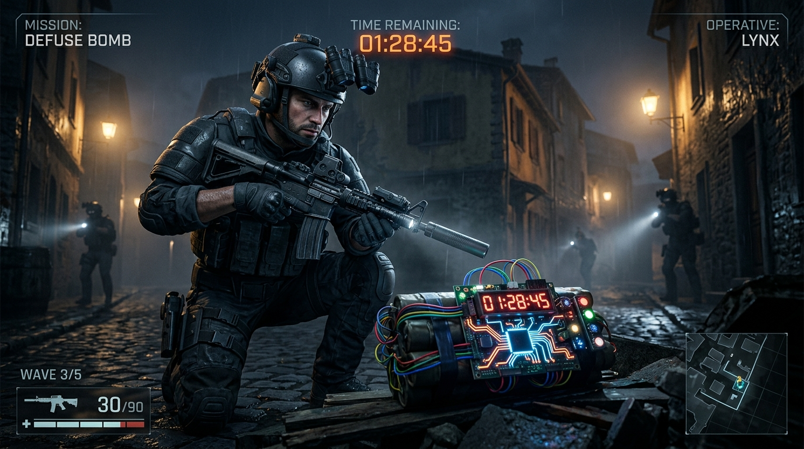

[](https://threejs.org/)
[](https://vitejs.dev/)
[](https://developer.mozilla.org/en-US/docs/Web/JavaScript)
[](https://developer.mozilla.org/en-US/docs/Web/API/Web_Audio_API)
[](./LICENSE)
[](https://snigdha-0210.github.io/Bomb_Defusal/)
[]()

**An intense, atmospheric 3D tactical FPS and bomb defusal simulation built from the ground up for modern browsers with Three.js and Vite.**

[🌐 Play Online (Live Demo)](https://snigdha-0210.github.io/Bomb_Defusal/) • [🎮 Play Locally](#-quick-start--local-play) • [🚀 Cloud Deployment](#-deployment--hosting) • [🕹️ Tactical Controls](#-tactical-controls--keybindings) • [🏗️ System Architecture](#-system-architecture)

</div>

---

## 📖 Mission Briefing

In **Bomb Defusal**, you are deployed solo into an occupied European village under nocturnal lockdown. Hostile mercenary squads patrol the cobblestone streets and alleyways, guarding a high-yield C4 explosive rigged to detonate on a hair-trigger countdown.

Your objectives:
1. **Infiltrate the perimeter**: Navigate rain-swept alleys, flank patrol paths, and maintain spatial awareness.
2. **Neutralize hostile squads**: Engage four specialized enemy classes using ADS precision marksmanship and tactical cover.
3. **Scavenge tactical drops**: Collect dynamic 3D health medkits and ammo crates dropped by neutralized hostiles.
4. **Locate and defuse the charge**: Breach the bomb perimeter and sever the correct circuit sequence before the detonator reaches zero.

---

## 📸 Tactical Gallery

<div align="center">

| 🎯 Aim Down Sights (ADS) & Combat | ✂️ Interactive C4 Defusal Console |
|:---:|:---:|
| 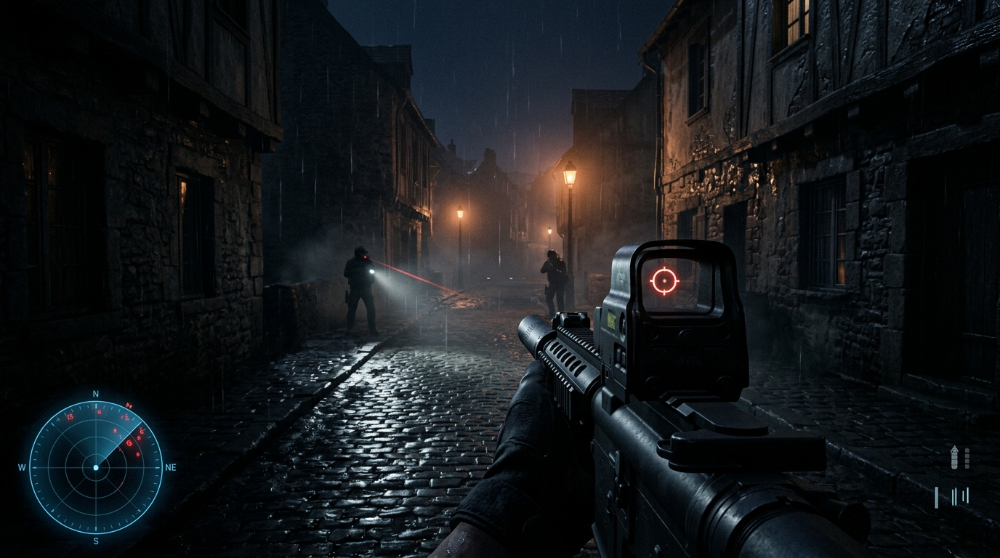 | 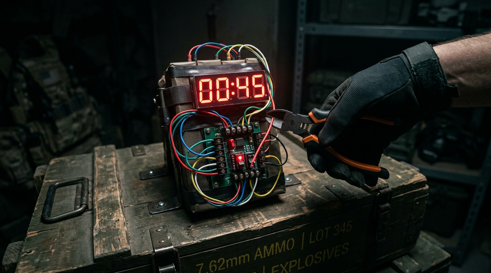 |
| *Nocturnal village firefights with ADS zoom and dynamic weather* | *Proximity-triggered wire circuit console with randomized logic* |

| 🪖 Hostile Sentry Archetypes |
|:---:|
| 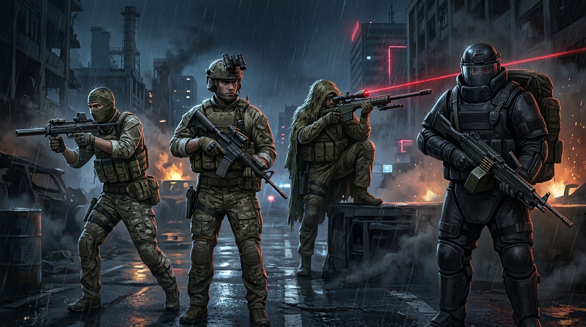 |
| *Assault Rifleman, Scout Rusher, Marksman Sniper (Laser Sight), & Heavy Enforcer* |

</div>

---

## ✨ Key Tactical Features

- 🎯 **Full First-Person 3D Locomotion**: Hardware-accelerated camera control using `PointerLockControls`, WASD movement, sprint multiplier, jumping physics, and continuous bounding-box collision sliding against village architecture.
- 🔭 **Precision Aim Down Sights (ADS)**: Smooth weapon viewmodel centering with FOV zoom transition from $75^\circ$ to $48^\circ$, tightening bullet spread and weapon sway.
- 🔫 **Realistic Magazine & Ballistics System**: 30-round magazine with 90 reserve rounds, procedural reload animations (`R`), muzzle flashes, shell ejection, and recoil displacement.
- 🔊 **Zero-Asset Procedural Audio Engine**: 100% procedural sound synthesis built on Web Audio API oscillators, biquad filters, and noise buffers — synthesizing punchy gunshots, hitmarkers, headshot chimes, reload mechanical snaps, heart-pounding bomb tempo beeps, wire snips, and victory fanfares.
- 🌧️ **Dynamic Atmosphere & Particle VFX**: Environmental weather simulation including nocturnal fog, volumetric rain particles, atmospheric lightning flashes with rolling thunder, bullet impact sparks, blood hits, and directional screen shake.
- 📡 **Tactical Sonar Radar HUD**: Real-time 2D circular HUD scanner rendering hostiles in range, current view cone orientation, and a pulsing waypoint toward the explosive device.
- 🪖 **Multi-Class Hostile Combatants**:
  - **🛡️ Assault Guard**: Balanced rifleman executing cover strafing and fire bursts.
  - **⚡ Scout Rusher**: High-speed flanker sprinting aggressively to close the distance.
  - **🎯 Marksman Sniper**: Sentry holding vantage positions equipped with an active, visible red laser targeting sight.
  - **🦾 Heavy Enforcer**: High-durability boss combatant anchoring the bomb perimeter.
- 📦 **3D Tactical Supply Drops**: Fallen combatants drop glowing, rotating 3D Medkits ($+35$ HP) and Ammo Crates ($+30$ Rounds).
- 🏆 **Campaign Level Progression & Scoring**: Seamless transitions across escalating operations (Infiltration $\rightarrow$ Thunderstorm Siege $\rightarrow$ Rooftop Marksmen $\rightarrow$ Red Alert Outpost) culminating in an interactive Victory Debrief ranking performance by accuracy, headshots, combat time, and kills.

---

## 🕹️ Tactical Controls & Keybindings

| Key / Input | Action | Tactical Function |
|---|---|---|
| **Mouse Move** | **Aim / Look** | 360° pitch and yaw camera control with pointer lock |
| **Left Click** | **Fire Weapon** | Raycast ballistics shot; emits acoustic sound impulse alerting nearby guards |
| **Right Click (Hold)** | **Aim Down Sights (ADS)** | Zooms FOV to $48^\circ$, centers iron sights for pinpoint long-range accuracy |
| **`W` `A` `S` `D`** | **Tactical Movement** | Move forward, strafe left, backpedal, and strafe right |
| **`Shift` (Hold)** | **Sprint** | Multiplies ground movement speed by $1.65\times$ |
| **`Space`** | **Jump** | Vertical leap with gravity acceleration and ground collision snapping |
| **`R`** | **Reload** | Swaps spent magazine with fresh ammo ($30\text{ rounds}$) |
| **`E`** | **Interact / Defuse** | Activates the bomb wire console when within $4.8\text{m}$ proximity |
| **`Esc`** | **Pause / Release Mouse** | Releases pointer lock to access menus |

---

## 🏗️ System Architecture

The project is structured with high-cohesion, low-coupling ES modules orchestrating Three.js graphics, procedural audio synthesis, physics, and autonomous AI agents:

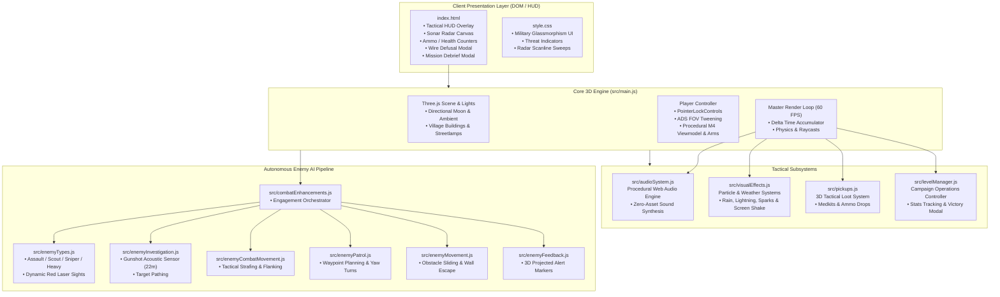

---

## 🔄 Frame Execution & Game Loop

Each animation frame executes a deterministic sequence of updates:

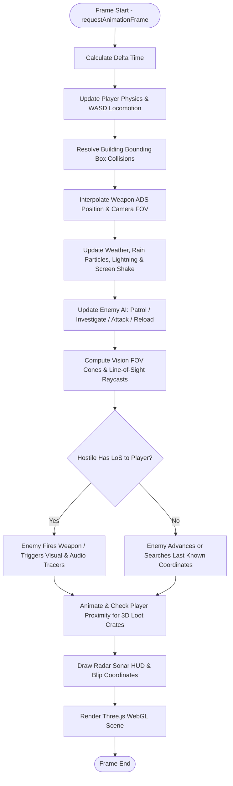

---

## 🧠 Enemy AI & Tactical Finite State Machine

Hostile sentries do not wander aimlessly—they operate using an intelligent multi-state FSM reacting to line of sight, acoustic stimuli, and magazine status:

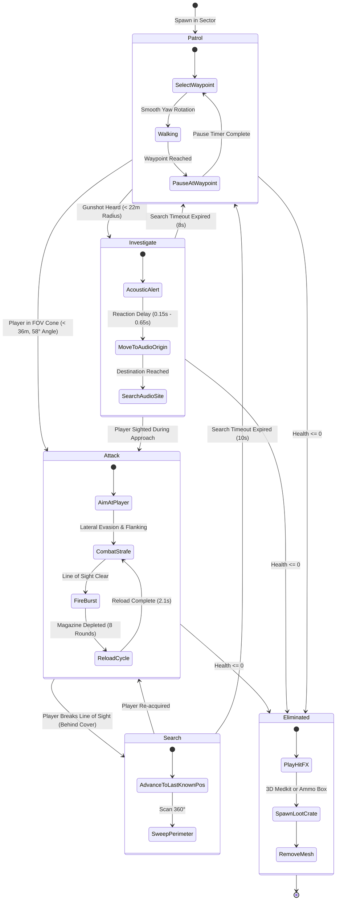

### 🔊 Acoustic Sensor Sequence

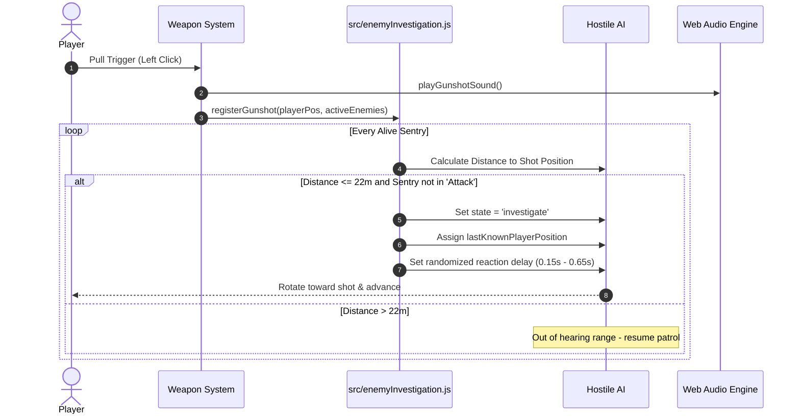

---

## 🪖 Enemy Archetypes Comparison

| Archetype | Icon | Base HP | Speed | Combat Role | Special Attributes | Loot Chance |
|---|:---:|:---:|:---:|---|---|:---:|
| **Assault Guard** | 🛡️ | $100$ | $1.0\times$ | Standard Rifleman | Balanced strafing, disciplined 3-round bursts | 50% Ammo |
| **Scout Rusher** | ⚡ | $70$ | $1.4\times$ | Aggressive Flanker | Rapid closing speed, erratic evasion sprints | 60% Ammo |
| **Marksman Sniper** | 🎯 | $85$ | $0.85\times$ | Long-Range Overwatch | **Active Red Laser Sight**, elevated roof vantage, high damage | 50% Medkit |
| **Heavy Enforcer** | 🦾 | $220$ | $0.65\times$ | Area Denial Boss | Ballistic shield armor, guards bomb site, heavy rate of fire | 100% Crate |

---

## 🧩 Bomb Defusal Puzzle System

Breaching within $4.8\text{m}$ of the high-explosive device prompts the operator to press **`E`**, opening the defusal terminal:

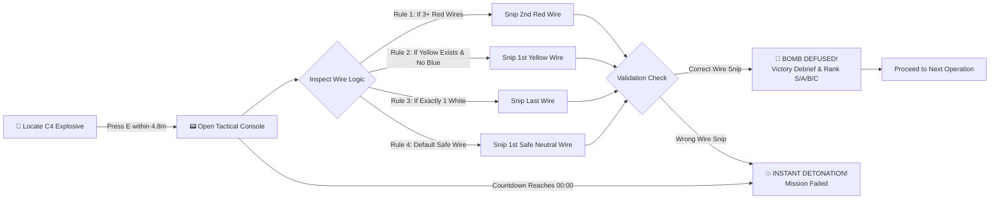

### 🎨 Wire Circuit Rules Matrix

The bomb generator assigns wire colors dynamically every round according to procedural electronic circuit logic:

| Wire Configuration | Target Wire to Snip | Consequence of Error |
|---|---|---|
| **Multiple Red Wires ($\ge 2$)** | Cut the **second Red wire** from the left | Instant Detonation |
| **Yellow Present & Zero Blue Wires** | Cut the **first Yellow wire** | Timer Penalty (-15s) |
| **Exactly One White Wire Present** | Cut the **very last wire** on the terminal | Instant Detonation |
| **Even Number of Blue Wires** | Cut the **second Blue wire** | Instant Detonation |
| **All Else / Fallback** | Cut the **first safe neutral wire** | Timer Penalty (-10s) |

---

## 📈 Campaign Operations & Difficulty Scaling

Each operation introduces harsher conditions, smarter hostile squad compositions, and reduced defusal windows:

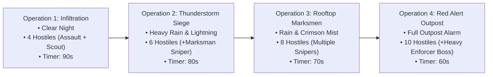

| Operation | Environment & Weather | Hostile Count | Sentry Composition | Defusal Countdown |
|---|---|:---:|---|:---:|
| **Op 1: Infiltration** | Calm Nocturnal Fog | 4 | 3 Assault, 1 Scout Rusher | $90\text{s}$ |
| **Op 2: Thunderstorm Siege** | Heavy Rainstorm & Lightning | 6 | 3 Assault, 2 Scouts, 1 Marksman Sniper | $80\text{s}$ |
| **Op 3: Rooftop Marksmen** | Thunder, Rain & Red Alerts | 8 | 4 Assault, 2 Scouts, 2 Marksman Snipers | $70\text{s}$ |
| **Op 4: Red Alert Outpost** | High-Intensity Combat Fog | 10 | 4 Assault, 3 Scouts, 2 Snipers, 1 Heavy Enforcer | $60\text{s}$ |

---

## 🔊 Procedural Web Audio Engine Architecture

No large external audio files are required! Sound effects are mathematically synthesized in real time via the Web Audio API:

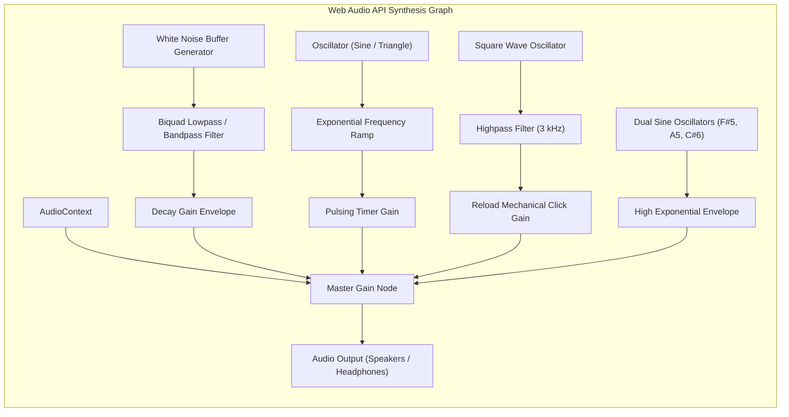

- **Gunshots**: White noise bursts fed through a steep lowpass filter with rapid exponential decay ($0.12\text{s}$).
- **Hitmarkers & Headshots**: High-frequency dual sine chords ($1200\text{Hz}$ / $1760\text{Hz}$) for crisp acoustic confirmation.
- **Reloading**: Dual mechanical clicks with distinct pitch shifts simulating magazine release and seat insertion.
- **Bomb Timer Beeps**: Pitch-escalating sine pings with accelerating tempo as the clock ticks down toward zero.

---

## 📁 Repository Structure

```
BombDefusalGame/
├── assets/
│   ├── banner.jpg                  # Primary cinematic game banner
│   ├── gameplay_tactical.jpg       # ADS tactical gameplay action showcase
│   ├── bomb_defusal_console.jpg    # Close-up wire defusal terminal showcase
│   └── enemy_archetypes.jpg        # Tactical squad archetypes lineup
├── dist/                           # Optimized production bundle generated by Vite
├── src/
│   ├── main.js                     # Core Three.js engine, map, player physics, ADS & radar HUD
│   ├── audioSystem.js              # 100% procedural Web Audio sound synthesis engine
│   ├── visualEffects.js            # Particle systems: weather, rain, lightning, sparks & screen shake
│   ├── enemyTypes.js               # Enemy class archetypes & sniper dynamic red laser sight
│   ├── pickups.js                  # 3D interactive tactical loot drops (Medkits & Ammo boxes)
│   ├── levelManager.js             # Campaign level progression, scoring formulas & Victory debrief
│   ├── combatEnhancements.js       # Advanced combat AI orchestrator & wire puzzle UI
│   ├── enemyMovement.js            # Bounding box obstacle sliding & 8-direction escape logic
│   ├── enemyPatrol.js              # Sector patrol routes, waypoint turns & stuck recovery
│   ├── enemyCombatMovement.js      # Tactical strafing, flanking, and distance management
│   ├── enemyFeedback.js            # 3D-to-2D projected alert markers & enemy spotted banners
│   └── enemyInvestigation.js       # Acoustic gunshot sensor & pathing toward sound origin
├── index.html                      # Semantic HTML5 HUD shell, radar canvas, and wire modal
├── style.css                       # Military glassmorphism styling, crosshairs & radar animations
├── package.json                    # Project configuration, dependencies, and npm scripts
├── PROJECT_STATE.md                # Comprehensive developer log and architectural reference
├── LICENSE                         # MIT License
└── .gitignore                      # Git ignore patterns
```

---

## 🚀 Quick Start & Local Play

### Prerequisites
- [Node.js](https://nodejs.org/) (version 18+ recommended)
- Any modern WebGL-compatible browser (Google Chrome, Microsoft Edge, Mozilla Firefox, Brave, Safari)

### Installation & Launch

1. **Clone the repository**:
   ```bash
   git clone https://github.com/Snigdha-0210/Bomb_Defusal.git
   cd Bomb_Defusal
   ```

2. **Install project dependencies**:
   ```bash
   npm install
   ```

3. **Start the local development server**:
   ```bash
   npm run dev
   ```

4. **Play the game**:
   Open **`http://localhost:5173/`** in your browser. Click anywhere on the screen to lock your mouse cursor and start playing!

5. **Build for production**:
   ```bash
   npm run build
   ```

---

## 🌐 Deployment & Hosting

The game can be deployed for free with zero server maintenance on either **GitHub Pages** or **Render**:

### Option 1: GitHub Pages (Automated via GitHub Actions)
The repository includes a ready-to-use GitHub Actions workflow (`.github/workflows/deploy.yml`):
1. In your GitHub repository, navigate to **Settings** $\rightarrow$ **Pages**.
2. Under **Build and deployment** $\rightarrow$ **Source**, select **`GitHub Actions`**.
3. Push any commit to `main` (or run the workflow manually from the **Actions** tab).
4. Your game will automatically build and publish to:
   ```
   https://<your-username>.github.io/Bomb_Defusal/
   ```

### Option 2: Render (Static Site)
The repository includes a pre-configured `render.yaml` specification:
1. Go to your [Render Dashboard](https://dashboard.render.com/) and click **New** $\rightarrow$ **Static Site**.
2. Connect this repository (`Snigdha-0210/Bomb_Defusal`).
3. Fill in the build settings (or select Blueprints to read `render.yaml` automatically):
   - **Build Command**: `npm install && npm run build`
   - **Publish Directory**: `dist`
4. Click **Create Static Site** — Render will build and host your game with global CDN and automated SSL!

### Option 3: Vercel / Netlify
- **Build Command**: `npm run build`
- **Output Directory**: `dist`

---

## 🛠️ Performance & Optimization

- **Draw Call Efficiency**: Geometries are merged or reused via shared materials for village houses, crates, and street props.
- **Hardware Pointer Lock**: Utilizes the native W3C Pointer Lock API for smooth mouse control without cursor drift.
- **Zero Heavy Audio Files**: 0 MB sound assets loaded over network—all audio is generated purely on the client CPU via Web Audio API.
- **Adaptive Delta Timing**: Clamped physics timestep prevents tunneling or falling through geometry on frame rate drops.

---

## 📄 License

This project is licensed under the **MIT License**. See the [`LICENSE`](./LICENSE) file for complete details.

<div align="center">
  <sub>Crafted with passion for tactical web gaming • Designed & Developed by <a href="https://github.com/Snigdha-0210">Snigdha</a></sub>
</div>
